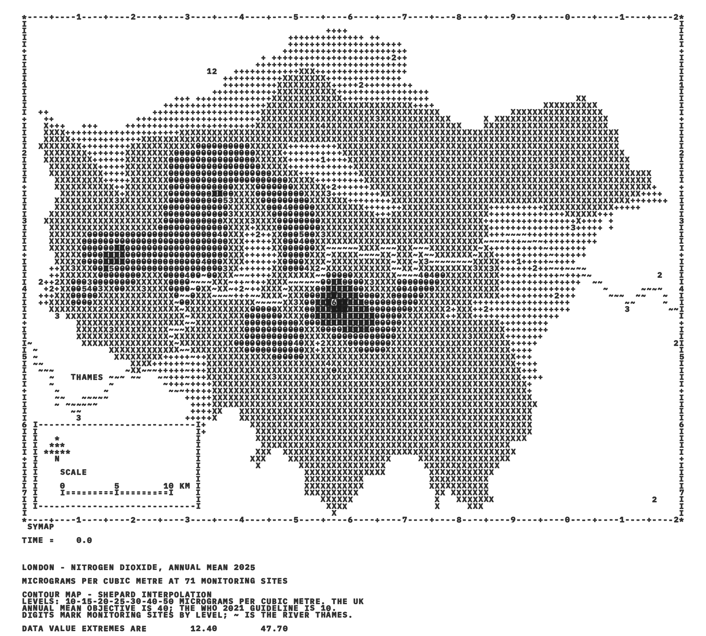

# symap

An implementation of SYMAP, the Synagraphic Mapping System: the
line-printer mapping program developed at the Harvard Laboratory for
Computer Graphics and Spatial Analysis by Howard Fisher and Betty Benson. It
reads SYMAP card decks and prints maps made of overprinted characters,
following the 1971 program manual.



*`examples/decks/london-no2.sym`: annual mean NO₂ at 71 London monitoring
sites, 2025 (Defra UK-AIR, OGL v3.0), as exported from the browser version.
The image contains its deck: drop it on the editor to load it.*

The core is written in Rust. It runs from the command
line, or compiled to WebAssembly in the browser at
<https://urschrei.github.io/SYMAP/>.

## Running it

```bash
cargo run -- examples/decks/example-1-14.sym
```

```bash
cargo run -- --asa examples/decks/hills.sym
```

Plain output prints one character per position, with single characters
standing in for overprints (`Θ` for `O`+`-`, `⊗` for `O`+`X`, `█` for
`O`+`X`+`A`+`V`, and otherwise the stack's darkest character). On a
terminal the map prints on a sheet of paper whose cells are shaded grey to
make up each overprint's ink, so the tones read as they do on the printout.
`--color never` (or `NO_COLOR`) turns that off and `--color always` forces it,
say for `less -R`; it uses 24-bit greys when `COLORTERM` is `truecolor`,
otherwise the 256-colour palette's. `--asa` writes Fortran carriage control instead: a line
starting with `+` overprints the line above, which is how the line printer
struck darker tones. `--values` writes the values computed for maps that use
elective 21, as CSV.

`symap import` makes a deck from points or polygons with values, in CSV,
GeoJSON or TopoJSON, with lines such as rivers drawn on the map or used as
barriers:

```bash
cargo run -- import stations.csv --value no2 > no2.sym
```

The browser version has a card editor with field guides, the example decks
and the same importer. It draws each overprint layer onto green-bar or white paper, upright
or sideways, and can download the output as text, ASA or CSV, or each map
as a 300 dpi PNG that prints at the original size. The PNG contains the deck
that made it as an iTXt chunk (this can be turned off), and dropping it on the editor
restores the deck.

## What it covers

- Contour, proximal and conformant maps, with every package in the 1971
  manual: outlines, conformolines, data points, legends, barriers, values
  and a values index.
- Every elective in the 1971 manual (1 to 28 and 31 to 37; the manual has
  no 29 or 30). Electives 38 and 39 (Version 6's data graph and regression
  plane) are not implemented.
- Shepard's interpolation as SYMAP implemented it, including barriers.
- The printed page: the tables before the map, the bordered map (in
  13-inch panels when wider), titles, numeric interpretation and the
  frequency distribution, laid out as in the manual's examples.

The output has been compared with the manual's printouts, character by
character. Agreement ranges from 94% (Example 1-5, a contour map) to 99.5%
(Example 1-17, a proximal map).

## Examples

| Deck | Map |
|------|-----|
| `example-1-3.sym` | The manual's Example 1-3: a contour map measured in rows and columns |
| `example-1-14.sym` | The manual's Example 1-14: two proximal maps with legends |
| `example-1-20.sym` | The manual's Example 1-20: a conformant map of six zones |
| `hills.sym` | Contour and proximal maps of 40 spot heights |
| `districts.sym` | A conformant map of six districts |
| `barrier.sym` | A river as an impermeable barrier, with and without it |
| `furniture.sym` | A lettered title, north arrow and scale inset drawn with legends |
| `london-boroughs.sym` | Population density of the London boroughs, Census 2021, with the Thames |
| `london-no2.sym` | Annual mean nitrogen dioxide at 71 London monitoring sites, 2025 |
| `london-house-prices.sym` | Central London median house prices, with the Thames as a barrier and without |
| `london-zones.sym` | Fare zone of the nearest of 574 London rail stations |
| `london-suitability.sym` | Two weighted suitability indexes on a 1 km grid of London, after Steinitz's Delmarva study |
| `london-attractiveness.sym` | A regression of house prices on site factors, printed on the same grid, after Steinitz's Boston attractiveness map |
| `dublin-density.sym` | Population density of Dublin City's electoral divisions, Census 2022, with the Liffey |
| `dublin-housing.sym` | Housing density of the same divisions in central Dublin at twice the scale, as a conformant map and as a contour map forced from the zones (elective 27) |

The manual's decks are transcribed card for card and checked against the
scans. `hills`, `districts`, `barrier` and `furniture` use made-up data. The
London and Dublin decks use published open data; deck headers list
sources, licences and simplifications.

## Documentation

The first two guides are also published with the
[browser version](https://urschrei.github.io/SYMAP/docs/your-own-data.html).

- [Mapping your own data](docs/your-own-data.md): a worked example from a
  CSV file to a printed map, and recipes for other kinds of data.
- [Writing decks](docs/decks.md): packages, electives and symbolism.
- [Importing data](docs/importing.md): making a deck from CSV, GeoJSON or
  TopoJSON.
- [Interpolation](docs/interpolation.md): how values are computed, and how
  the search radius was recovered from the manual's printouts.
- [Comparison with the manual](docs/fidelity.md): how the output was
  checked, the results, and the questions that remain open.
- [The browser version](docs/browser.md): building the site, the
  WebAssembly interface and the printout's rendering.

## References

- Goodrich, J. C. (ed.) and Howrigan, G. (assoc. ed.) (1971). *Computer
  Mapping as an Aid in Air Pollution Studies*, Vol. 2, Report K: Computer
  Program Manuals. Laboratory for Computer Graphics and Spatial Analysis,
  Graduate School of Design, Harvard University. NTIS PB 204 713
  (APTD-0738). Scan: <https://archive.org/details/micro_IA41159411_0506>
- Shepard, D. (1968). A two-dimensional interpolation function for
  irregularly-spaced data. *Proceedings of the 1968 23rd ACM National
  Conference*, 517–524. <https://doi.org/10.1145/800186.810616>
- Shepard, D. S. (1970). *SYMAP Interpolation Characteristics*. Computer
  Mapping as an Aid in Air Pollution Studies, Vol. 2, Report L. Laboratory
  for Computer Graphics and Spatial Analysis, Harvard University. NTIS PB 204
  180 (APTD-0787). Scan: <https://archive.org/details/micro_IA41159411_0474>
- Shepard, D. (1984). Computer Mapping: The SYMAP Interpolation Algorithm.
  In G. L. Gaile & C. J. Willmott (eds), *Spatial Statistics and Models*,
  Springer, 133–145. <https://doi.org/10.1007/978-94-017-3048-8_7>

## Licence

[Blue Oak Model License 1.0.0](LICENSE.md).
